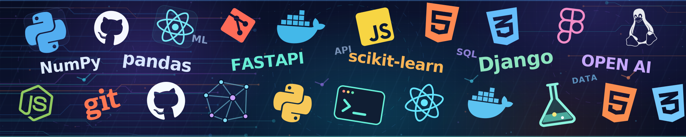

<!--
  Muhammad Talha | GitHub Profile README
  This README appears on your GitHub profile when placed in a PUBLIC
  repository named exactly MuhammadTalha1404/MuhammadTalha1404.
-->

  

  

  

## About me

I'm **Muhammad Talha**, a **Software Engineering graduate, Project Manager, and Python Developer** with interests spanning **project delivery, technical project management, and software development**.

I currently work as a **Project Manager**, coordinating team members and stakeholders, organizing tasks and priorities, tracking progress and deadlines, and reviewing deliverables to keep projects on track. My software engineering background helps me understand technical requirements, communicate with development teams, and approach problems from both a delivery and engineering perspective.

On the development side, I build **Python-based web applications, backend systems, AI-powered tools, and machine learning projects**. I enjoy working with **Django, Flask, FastAPI**, and full-stack technologies to turn ideas into practical solutions.

- **Project management:** Task planning, team coordination, progress tracking, stakeholder communication, and quality assurance.
- **Technical focus:** Python development, backend systems, APIs, AI/ML, and full-stack applications.
- **How I work:** Clear requirements, realistic deadlines, collaborative problem-solving, and reliable delivery.

## Technologies & tools

**Languages and development**

  

**Frameworks and application development**

  

**AI, machine learning and data**

  
  
  
  
  

**Project management & collaboration**

  
  
  
  

## Featured projects

<table>
  <tr>
    <td width="50%" valign="top">
      <h3><a href="https://github.com/MuhammadTalha1404/Solar-PV-Digital-Twin">Solar PV Digital Twin</a></h3>
      
An interactive solar-energy simulation that uses machine learning to forecast photovoltaic power generation. Includes NASA POWER weather data, model training, and a FastAPI prediction backend.

      
<code>Python</code> <code>Random Forest</code> <code>XGBoost</code> <code>LSTM</code> <code>FastAPI</code>

      <a href="https://github.com/MuhammadTalha1404/Solar-PV-Digital-Twin">View repository →</a>
    </td>
    <td width="50%" valign="top">
      <h3><a href="https://github.com/MuhammadTalha1404/Airdesk-HVAC-AI-Receptionist">AirDesk — AI Receptionist</a></h3>
      
A locally tested HVAC-business application with an owner dashboard, customer workflows, AI conversation tooling, and adapters for scheduling, calls, and billing. Live integrations require configuration and validation.

      
<code>Python</code> <code>FastAPI</code> <code>SQLAlchemy</code> <code>Integrations</code>

      <a href="https://github.com/MuhammadTalha1404/Airdesk-HVAC-AI-Receptionist">View repository →</a>
    </td>
  </tr>
  <tr>
    <td width="50%" valign="top">
      <h3><a href="https://github.com/MuhammadTalha1404/LearnIslam-AI-Tutor">LearnIslam AI Tutor</a></h3>
      
A chat-based educational assistant designed to make Quran- and Hadith-related learning easier to explore, built as part of the QuranConnect final-year project.

      
<code>Python</code> <code>Django</code> <code>ChromaDB</code> <code>NLP</code>

      <a href="https://github.com/MuhammadTalha1404/LearnIslam-AI-Tutor">View repository →</a>
    </td>
    <td width="50%" valign="top">
      <h3><a href="https://github.com/TalhaFarooq82/QuranConnect">QuranConnect</a></h3>
      
A collaborative final-year project for Quran learning and tutoring, with tutor discovery, real-time messaging, Quran/Hadith AI assistance, recitation feedback, and payment workflows.

      
<code>Python</code> <code>Django</code> <code>PostgreSQL</code> <code>ChromaDB</code> <code>Whisper</code>

      <a href="https://github.com/TalhaFarooq82/QuranConnect">View repository →</a>
    </td>
  </tr>
</table>

### More things I've built

- **[UMT Chatbot](https://github.com/MuhammadTalha1404/UMT-Chatbot)** — A university handbook question-answering assistant using Flask, FAISS, LangChain, and OpenAI.
- **[Supermarket Management System](https://github.com/MuhammadTalha1404/Supermarket-Management-System)** — A Streamlit-based business management application with sales, stock, roles, and reports.
- **[Python Data Science Foundations](https://github.com/MuhammadTalha1404/python-data-science-foundations)** — Practical notebooks covering NumPy, Pandas, Matplotlib, and Seaborn.

## Languages across my repositories

  

> This card reflects the languages in public repository code, not a ranking of proficiency. It is provided by a third-party service and may occasionally be unavailable.

## Connect

Open to connecting about **project management, technical project delivery, Python development, and applied AI**.

  
  

<strong>From planning and coordination to practical solutions.</strong>

